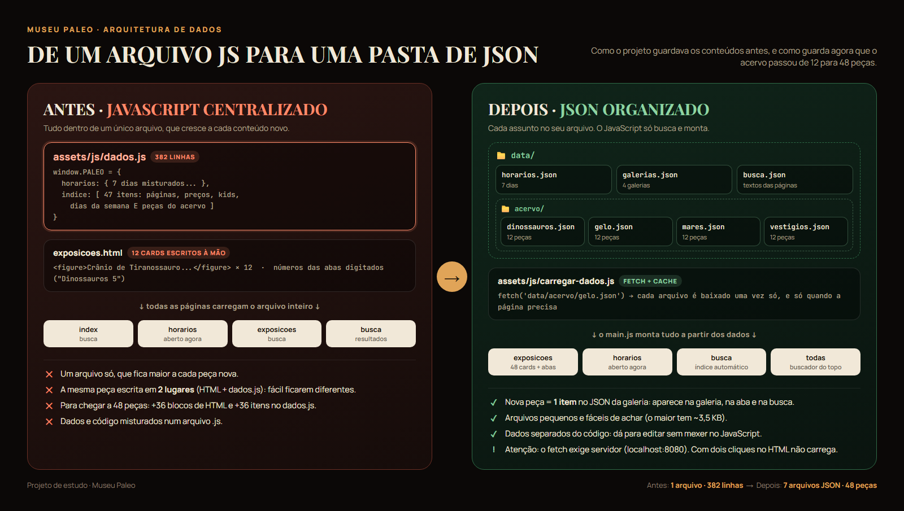

# Museu Paleo

Site institucional de um museu de pré-história, feito com **HTML, CSS (escrito em SCSS) e JavaScript**.
O relatório [RELATORIO-PHP.md](RELATORIO-PHP.md) compara esta versão com a antiga, que usava PHP.

## Páginas

- `index.html`: Home (o museu, interesses e Kids)
- `horarios.html`: horário de funcionamento, dicas e status "Aberto agora"
- `valores.html`: valores dos ingressos e condições especiais
- `exposicoes.html`: galeria do acervo com filtros (aceita `?galeria=gelo`, `dinossauros`, `mares` ou `vestigios`)
- `sobre.html`: história do museu
- `busca.html`: resultados do buscador

## Como abrir

Na pasta do projeto:

```bash
php -S localhost:8080
```

Depois abra http://localhost:8080. Com o servidor PHP ligado, aparece também o botão redondo
"Atualizar GitHub" no canto inferior direito (ele usa `sync.php` e `painel.php`).

## CSS com SASS (SCSS)

**Não edite o `assets/css/style.css` direto:** ele é gerado a partir da pasta `scss/`.

```
scss/
  main.scss                junta tudo, na ordem
  abstracts/_variaveis.scss  breakpoints ($tela-tablet...) e mixins (abaixo-de, acima-de)
  base/                    tokens de cor, reset, componentes reaproveitados
  layout/                  cabeçalho e rodapé
  secoes/                  hero, o museu, horários, valores, kids, interesses
  paginas/                 exposições, sobre, busca
  componentes/             botão "Atualizar GitHub"
  _responsivo.scss         ajustes para telas menores
```

Para gerar o CSS:

- **Dois cliques em `compilar-css.bat`**: compila uma vez.
- `compilar-css.bat vigiar`: recompila sozinho sempre que um `.scss` é salvo.

Precisa do **Dart Sass Standalone** (sem Node e sem npm): baixe o `windows-x64.zip` em
https://github.com/sass/dart-sass/releases e descompacte em `%USERPROFILE%\ferramentas\dart-sass-1.107.0`.

## Scroll suave

O scroll suave é feito pela biblioteca [Lenis](https://lenis.dev) (versão 1.3.4, carregada por CDN).
A configuração fica no começo do `assets/js/main.js`.

## Onde editar o conteúdo (pasta `data/`)



Os dados do site ficam em arquivos JSON separados por assunto:

```
data/
  horarios.json            dias e horários (usado no "Aberto agora" e no destaque de hoje)
  galerias.json            as 4 galerias do acervo (nome e identificador)
  acervo/
    dinossauros.json       12 peças
    gelo.json              12 peças
    mares.json             12 peças
    vestigios.json         12 peças
  busca.json               textos das páginas para o buscador
```

- **Adicionar uma peça:** acrescente um item no JSON da galeria. Ela aparece sozinha na página de Exposições,
  na contagem da aba e no buscador. Use `"imagem": null` para deixar o quadro preto até ter a foto.
- O arquivo `assets/js/carregar-dados.js` é quem busca esses JSON (com `fetch`).
- Por causa do `fetch`, o site **precisa ser aberto por um servidor** (ex.: http://localhost:8080).
  Com dois cliques no `index.html`, a galeria e a busca não carregam.

Os textos fixos das páginas (títulos, parágrafos, preços) continuam no HTML. O cabeçalho e o rodapé
estão copiados em cada página: para mudar o menu, é preciso editar todas.
